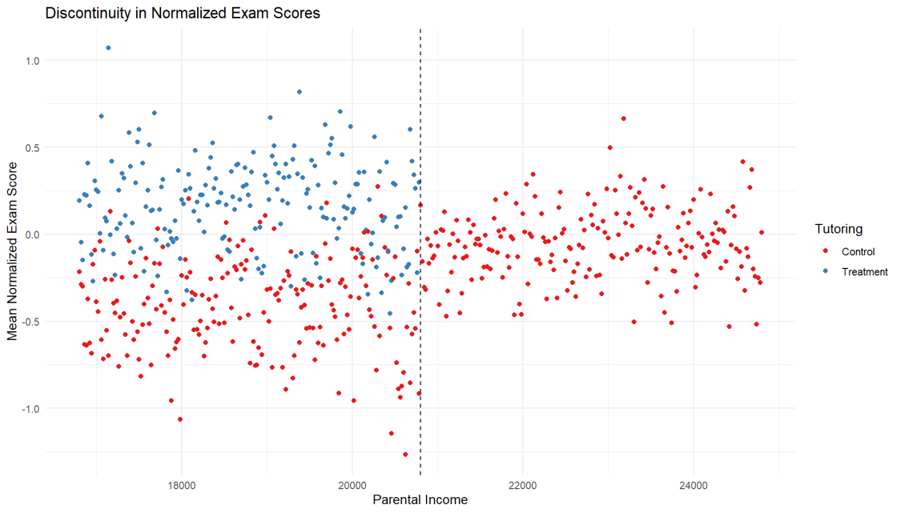

# Does free tutoring raise test scores? Policy evaluation with four causal designs (R)

**Research question:** a government programme gives 20 hours a month of free tutoring to Year 5 children from households earning **≤ £20,800**. Does it improve exam results?

I answered this on a panel of **40,000 children** (80,000 child-year observations) using four causal-inference methods. The interesting part is that they disagree, and the reason they disagree is the main finding.

This was the final project for Econometrics 2 at Royal Holloway, University of London (April 2023, individual).

`R` · `tidyverse` · `plm` · `AER::ivreg` · `sandwich` / `lmtest` (robust SEs) · `stargazer` · `ggplot2`

## Data work

Three sources, each in a different format, had to be joined into one panel:
- **National exams database** (`.RData`): exam scores for Years 4 and 5.
- **Department for Education** (`.csv`): parental income, tutoring take-up, tutor ID, distance to the nearest tutoring centre.
- **Child characteristics** (Stata `.dta`): age, gender, parental education, school.

The data then went through `pivot_longer` from wide to long format (one row per child per year). Exam scores were standardised within each year.

## Results

| Design | What it compares | Effect on test score (SD) | Significant? |
|---|---|---|---|
| Difference-in-differences | Tutored vs not, before vs after | **+0.179** (0.017) | *** |
| Child fixed effects | Same, within each child | **+0.179** (0.011) | *** |
| IV: eligibility letter as instrument | Effect for children who take up tutoring *because* they were invited | −0.023 (0.016) | no |
| Fuzzy RDD at £20,800 | Children just below vs just above the income cut-off | +0.020 (0.030) | no |
| Fuzzy RDD, narrow bandwidth (±£2,000) | Robustness check | −0.099 (0.101) | no |

Robust (HC1) standard errors in brackets. Outcome: exam score standardised within year.



*Mean standardised exam score by parental-income bin, Year 5, around the £20,800 cut-off. Below the line, tutored and non-tutored eligible children are mixed together. That's what makes the design "fuzzy".*

## What the disagreement means

Only about **52%** of eligible families took up tutoring (8,758 of 16,877), and no ineligible child received it. Who took it up was not random:
- **A logit of take-up** among eligible families shows gender, income, parental education and distance to the centre all predict participation.
- **The Hausman–Wu (control-function) test** rejects exogeneity of tutoring (first-stage residual coefficient 0.479, p < 0.01).

So the simple comparisons, DiD and fixed effects, pick up who *chooses* tutoring, not only what tutoring does. The designs that rely only on the eligibility rule, IV and RDD, find no significant effect:
- **IV:** the first stage is strong. The invitation raises the probability of take-up by 0.53 (SE 0.003).
- **RDD:** the result holds at a narrower bandwidth.

**My reading:** the evidence does not support a causal effect of the programme on test scores. The positive DiD estimate most likely reflects selection.

## What I'd do differently

These are things I noticed reviewing the project later:

- **Estimate the IV on Year 5 only, or on score changes.** The `treat` flag is 1 for tutored children in both years, including Year 4, before tutoring started. Pooling both years in the IV regressions mixes pre-programme scores into the "treated" group, which likely pulls the estimate towards zero. The RDD avoids this because it uses Year 5 only.
- **Compute the DiD from the data, not typed-in cell means.** The script reproduces the 2×2 DiD by hand from the cross-table. The regression version is the reproducible one.
- **Parallel trends can't be checked with two periods.** One more pre-programme year (Year 3) would allow a pre-trend test.
- **Use a local-linear RDD with a data-driven bandwidth** (e.g. `rdrobust`) instead of a global linear control plus one fixed narrower window.

## Running it

The data files were issued individually by the module and are **not included**. To run the script, place `DOE_data.csv`, `Child_data.dta` and `NED_data.RData` in `data/`, then:

```r
source("analysis.R")
```

Packages used: `readr`, `openxlsx`, `haven`, `dplyr`, `tidyr`, `summarytools`, `stargazer`, `ggplot2`, `knitr`, `sandwich`, `lmtest`, `plm`, `AER`, `car`, `rdd`.
